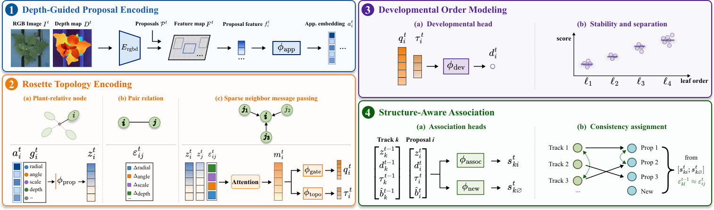
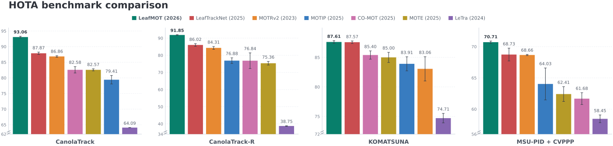
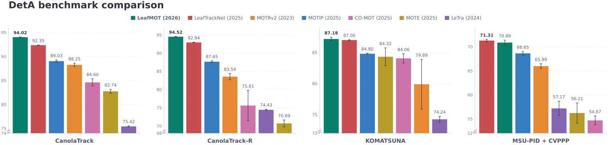
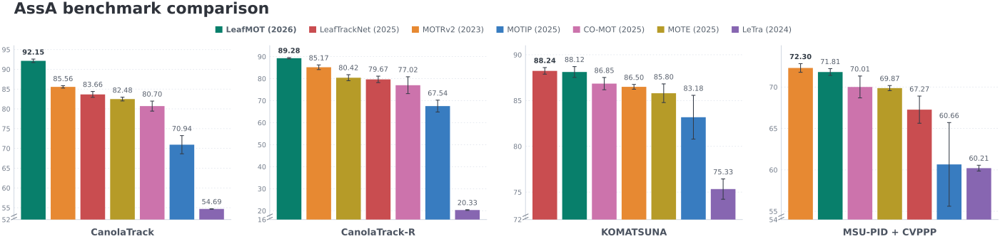

<div align="center">

  <h2>Structural Multi-Object Tracking of Individual Leaves in Rosette Plants</h2>

  <p>
    Shanghua Liu &nbsp;·&nbsp;
    Majharulislam Babor &nbsp;·&nbsp;
    Marina M.-C. Höhne
  </p>

  <p>
    Leibniz Institute for Agricultural Engineering and Bioeconomy, Germany
  </p>
  
</div>


## Overview

LeafMOT combines RGB-D appearance, plant-relative geometry, rosette topology and developmental order to track individual leaves through growth, overlap and changes in orientation.



## Results

LeafMOT achieves the highest mean HOTA on all four benchmarks(across three species), compared with six competing methods.



<details>
<summary><strong>Detection and association accuracy</strong></summary>





</details>

## Installation

```bash
conda create -n leafmot python=3.11 pip -y
conda activate leafmot
python -m pip install -r requirements.txt
python -m pip install -e . --no-deps
```

## Data preparation


```text
data/<dataset>/
├── train/<sequence>/
│   ├── img/             # 00000001.png, ...
│   ├── depth_da3/       # 00000001.npy, ...
│   └── gt/gt.txt        # MOT-format annotations
└── val/<sequence>/
    ├── img/
    ├── depth_da3/
    └── gt/gt.txt
```

Use eight-digit frame names and float32 depth arrays aligned with the RGB images. Annotation rows follow `frame,id,x,y,width,height,confidence,-1,-1,-1`.

**Detector proposals.** Provide one JSON file per split. Each value is a list of `x,y,width,height,confidence` strings in original image pixels; include every frame, using `[]` for empty detections.

```json
{
  "train/plant_001/00000001.txt": ["120,80,42,55,0.97"],
  "train/plant_001/00000002.txt": []
}
```

<details>
<summary><strong>Generate depth maps (optional)</strong></summary>

If depth maps are not available, install [Depth Anything 3](https://github.com/ByteDance-Seed/Depth-Anything-3) following its instructions, then run:

```bash
python scripts/precompute_depth.py \
  --data-root data/CanolaTrack \
  --proposal-json data/proposals/val.json \
  --splits train val \
  --da3-repo third_party/Depth-Anything-3 \
  --model-name depth-anything/DA3MONO-LARGE \
  --device cuda --save-npy --save-size original
```


</details>

## Training

```bash
# Single GPU
python scripts/train.py --config configs/config.yaml

# Multiple GPUs
torchrun --standalone --nproc_per_node={NUM_GPUs} scripts/train.py --config configs/config.yaml
```


## Inference

```bash
python scripts/infer_leafmot.py \
  --config outputs/leafmot/config.yaml \
  --checkpoint outputs/leafmot/weights/epoch_039.pth \
  --split val --device cuda
```

Evaluate the exported tracks with [TrackEval](https://github.com/JonathonLuiten/TrackEval) using the benchmark's settings.


