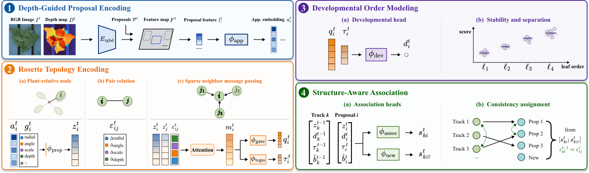
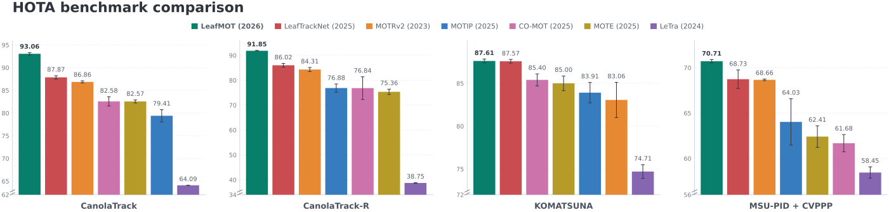

<div align="center">
  
</div>


<div align="center">
  
  
  
</div>

<p align="center">
  <strong>Structural Multi-Object Tracking of Individual Leaves in Rosette Plants</strong>
</p>

<p align="center">
  <a href="#overview">Overview</a> · <a href="#benchmark">Benchmark</a> · <a href="#citation">Citation</a>
</p>

> _This repository accompanies the manuscript under review. The framework overview and benchmark results are available now; the complete code release and reproduction instructions are being finalized and will be published shortly._

## Overview

LeafMOT is a structure-aware multi-object tracking framework for individual leaves in longitudinal, top-view images of rosette plants. Rather than associating leaves by appearance alone, it combines RGB features with monocular depth, plant-relative geometry, developmental order, and online track memory to maintain identities through growth, occlusion, and in-plane rotation.



| Stage | Role in tracking |
|:--|:--|
|  Depth-guided proposal encoding | Fuses RGB with estimated depth to embed each leaf proposal. |
|  Rosette topology encoding | Represents leaves relative to the plant, models pairwise relations, and aggregates sparse neighbor information. |
|  Developmental order modeling | Learns stable ordinal scores reflecting leaf emergence order. |
|  Structure-aware association | Computes scores for matching existing tracks and initializing new ones, favoring assignments that preserve rosette relations. |

## Benchmark

LeafMOT achieves the highest reported mean HOTA on all four evaluated benchmarks, compared with six competing methods.




## Citation

If you use CanolaTrack, CanolaTrack-R, or LeafMOT in your research, please cite the following papers.

```bibtex
@article{liu2026leafmot,
  title  = {LeafMOT: Structural Multi-Object Tracking of Individual Leaves in Rosette Plants},
  author = {Liu, Shanghua and Babor, Majharulislam and H{\"o}hne, Marina M.-C.},
  year   = {2026},
  note   = {Manuscript under review}
}
```

```bibtex
@article{liu2026leaftracknet,
title = {LeafTrackNet: A deep learning framework for robust leaf tracking in top-down plant phenotyping},
journal = {Computers and Electronics in Agriculture},
volume = {256},
pages = {112417},
year = {2027},
issn = {0168-1699},
doi = {https://doi.org/10.1016/j.compag.2026.112417},
author = {Shanghua Liu and Majharulislam Babor and Christoph Verduyn and Breght Vandenberghe and Bruno Betoni Parodi and Cornelia Weltzien and Marina M.-C. Höhne},
}
```


## Acknowledgements

LeafMOT builds on [Depth Anything 3](https://github.com/ByteDance-Seed/Depth-Anything-3), [DFormer](https://github.com/VCIP-RGBD/DFormer), and the broader multi-object tracking ecosystem. Please follow the licenses and citation requirements of the third-party models, datasets, and benchmarks used in your experiments.
